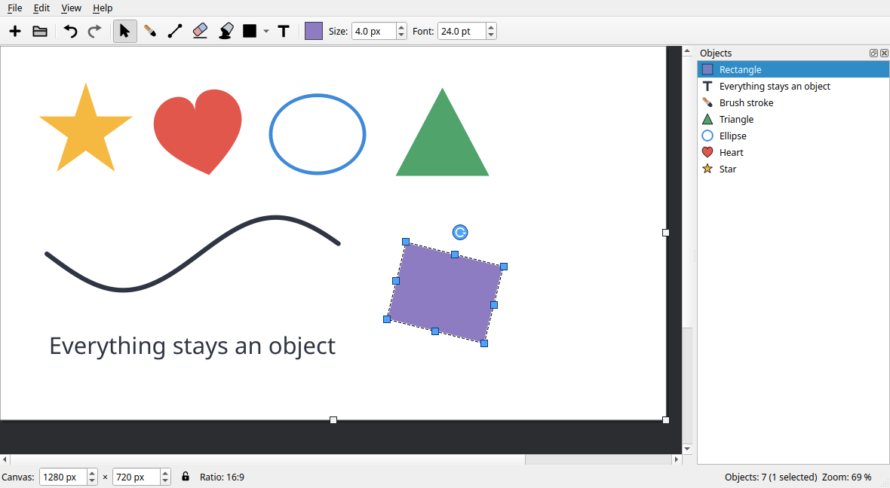

# Inkpot

**A paint program for Linux in which everything stays an object.**

[](../../releases/latest)
[](LICENSE)
[](https://paypal.me/CKrogmann)

*(Deutsche Fassung weiter unten — [zur deutschen Fassung](#inkpot-deutsch))*



Inkpot is a paint program written in C++ with Qt 6. Everything you draw stays
an object of its own: brush strokes, lines, shapes, captions, filled areas and
pasted pictures can be selected, moved, turned, scaled, recoloured and deleted
at any time.
Inkpot's own file format stores every object for later changes; the picture
exports as PNG, JPEG or BMP.

**[⬇ Download and install](../../releases/latest)** — for Ubuntu, Linux Mint
and Debian as a `.deb` package. To install it, simply open the downloaded file.
[For other distributions, see here](#other-distributions--from-source).

> ### ☕ Inkpot is free
>
> If you find it useful, you can support its development with a donation.
>
> [](https://paypal.me/CKrogmann)

## Features

**Tools**
* Selection, brush, straight line, shapes, bucket fill, eraser and text.
* Shapes: rectangle, ellipse, triangle, heart and star, solid or outlined.
  Hold Shift while dragging to keep the sides even.
* The eraser works *inside* objects: the erased area is left out, and it does
  so across several objects at once. The erased objects can still be worked
  on afterwards (text included!).
* The bucket fills enclosed areas, but works the area out on the rendered
  picture of the whole canvas. An area enclosed by several overlapping objects
  is therefore filled as one; the result is again an object of its own that
  can be worked with.
* Captions can be edited again with a double click, even once they have been
  erased into.

**Objects**
* Everything drawn or pasted becomes an object of its own.
* Select, move, scale through eight handles, turn with the round handle above
  the object, recolour, delete.
* Turning and scaling: a turned object keeps growing along its own edges
  instead of being distorted.
  Hold Shift while turning and it steps in 15 degree increments.
* Rubber band selection for several objects at once.
* Scaling a caption changes its font size rather than distorting it, and the
  value follows live in the font size field.

**Object list**
* A list on the right side shows every object.
* Picking a row selects the object on the canvas and the other way round;
  Ctrl for several rows, Shift for a block.
* View > Object List hides it again; the window remembers the setting.

**History**
* Undo and redo are available for drawing, filling, erasing, deleting, moving,
  turning, scaling, recolouring, editing a caption and resizing the canvas.

**Canvas**
* It sits fixed in the top left corner, resized with the handles on its right
  and bottom edge or by typing the size in the status bar.
* Lockable aspect ratio, with the current ratio shown as 4:3, 16:9 and so on

**Files**
* Project format `*.ipot` (JSON)
* Opens HEIF and HEIC pictures (what phones write by default)
* Exports as PNG, JPEG and BMP
* Copy to clipboard, paste, print

## Installing

### Ubuntu, Linux Mint and Debian — without the terminal

1. Open the **[releases page](../../releases/latest)** and, under *Assets*,
   download the file ending in **`.deb`** — it is called
   `inkpot_<version>_amd64.deb`.

   > Do not take "Source code (zip)" or "Source code (tar.gz)". That is the
   > source code for developers and cannot be installed by double-clicking.

2. Open the downloaded file with a **double click**. The package manager
   opens and asks for your password.
3. That is all — **Inkpot** is now in the application menu under *Graphics*.

The menu entry, the program icon and the file type for `*.ipot` are set up
along with it. Inkpot can be removed like any other program through the
software manager.

If you prefer the terminal:

```bash
cd ~/Downloads && sudo apt install ./inkpot_*_amd64.deb
```

The package is built for Ubuntu 24.04 / Mint 22.3 / Debian 13.7 and installs
on those and on anything newer. Older systems are untested. Updates do not
arrive on their own for now: watch the releases page, or use the
**Watch → Custom → Releases** button at the top of this project page to be
told about new versions. A Flatpak version will follow if it can be done, and
then updates would come through the software manager. Should that come to
nothing, I will build in a note about new versions.

### Arch, Manjaro, EndeavourOS

A `PKGBUILD` is in the repository. Nothing is published on the AUR yet, but
that one file is all it takes to install:

```bash
curl -O https://raw.githubusercontent.com/Neklor/Inkpot/main/packaging/aur/PKGBUILD
makepkg -si
```

The command fetches the release, compiles it and hands the package to pacman —
Inkpot can later be removed again with `pacman -R inkpot`.

### Other distributions — from source

Fedora, openSUSE and everything else:
compile Inkpot yourself, see [Compiling](#compiling). It needs nothing but
Qt 6 and a compiler.

A package on **Flathub** is being considered. That would make Inkpot findable
in the software managers of Linux Mint, Fedora and others.
Updates would then come through the system like any other program.

## Compiling

Requirements (Debian, Ubuntu, Linux Mint):

```bash
sudo apt install build-essential cmake ninja-build qt6-base-dev \
                 qt6-base-dev-tools qt6-l10n-tools libheif-dev \
                 qt6-image-formats-plugins libgl1-mesa-dev
```

Two of these are optional at build time. `qt6-l10n-tools` provides `lupdate`
and `lrelease` for the translations; without it Inkpot still compiles, it
simply runs untranslated. `libheif-dev` adds HEIF and HEIC support; without it
those files cannot be opened.

`qt6-image-formats-plugins` is not needed for compiling at all — Qt loads
those plugins while running. With it installed, **TIFF and WebP appear in the
export dialog** as well; the dialog only ever offers what Qt can really write
on that machine. The `.deb` pulls the package in on its own, so this only
concerns people who compile Inkpot themselves.

```bash
cmake -S . -B build -G Ninja -DCMAKE_BUILD_TYPE=Release
cmake --build build
./build/inkpot
```

Installing system wide:

```bash
sudo cmake --install build
sudo update-mime-database /usr/local/share/mime
sudo update-desktop-database /usr/local/share/applications
```

This installs the program, the desktop entry, the application icon, the
AppStream metadata, the MIME type for `*.ipot` and the translations.

## Keyboard shortcuts and mouse

Also shown in the program under **Help > Keyboard Shortcuts**; that list is
gathered from the menus themselves and therefore stays current.

| Action | Input |
| --- | --- |
| Selection | `S` |
| Brush | `B` |
| Line | `L` |
| Eraser | `E` |
| Bucket fill | `F` |
| Shapes | `R` |
| Text | `T` |
| Edit a caption later | double click with the selection tool |
| Recolour objects | select them, then the colour button |
| Undo / redo | `Ctrl+Z` / `Ctrl+Shift+Z` |
| Delete selection | `Del` |
| Select all | `Ctrl+A` |
| Zoom | `Ctrl` + mouse wheel, `Ctrl++`, `Ctrl+-` |
| Actual size / fit in window | `Ctrl+0` / `Ctrl+9` |
| Pan the view | drag with the middle mouse button |
| Turn in 15 degree steps | hold `Shift` while dragging the turning handle |
| Keep a shape even | hold `Shift` while drawing it |

## Translations

The strings in the sources are English; translations live in
[`translations/`](translations/) as Qt Linguist catalogues.

A translation can be edited either with `linguist6 translations/inkpot_de.ts`
or in a text editor, the files are readable XML:

```xml
<message>
    <source>&amp;Save</source>
    <translation>&amp;Speichern</translation>
</message>
```

Adding a language:

```bash
cp translations/inkpot_de.ts translations/inkpot_fr.ts
# set <TS ... language="fr_FR"> and list the file under
# INKPOT_TS_FILES in CMakeLists.txt
cmake --build build
```

After changing the sources,

```bash
cmake --build build --target update_translations
```

pulls new and changed strings into every `.ts` file.

## Packaging

| File | Purpose |
| --- | --- |
| `data/io.github.neklor.Inkpot.desktop` | application menu entry |
| `data/io.github.neklor.Inkpot.metainfo.xml` | AppStream data for software managers |
| `data/io.github.neklor.Inkpot.xml` | MIME type for `*.ipot` |
| `data/icons/hicolor/scalable/apps/…svg` | application icon |
| `flatpak/io.github.neklor.Inkpot.yml` | Flatpak manifest |
| `tools/build-deb.sh` | creates the Debian package |

Building a Flatpak locally:

```bash
flatpak install flathub org.kde.Platform//6.11 org.kde.Sdk//6.11
flatpak-builder --user --install --force-clean build-flatpak \
    flatpak/io.github.neklor.Inkpot.yml
flatpak run io.github.neklor.Inkpot
```

The screenshot shown at the top doubles as the picture in the software
managers; it lives in `docs/screenshot.png` and the AppStream file points
at it.

## Project structure

| Path | Contents |
| --- | --- |
| `src/main.cpp` | program start, translations, command line |
| `src/MainWindow.*` | menus, toolbar, status bar, file operations |
| `src/CanvasScene.*` | canvas, object handling, project format |
| `src/CanvasView.*` | view, tools, zoom |
| `src/ResizeHandle.*` | handles for canvas and objects |
| `src/StrokeItem.*` | object: brush stroke and line |
| `src/FillItem.*` | object: filled area |
| `src/ShapeItem.*` | object: shape |
| `src/HeifImage.*` | reading HEIF and HEIC pictures |
| `src/FloodFill.*` | working out the area a bucket fill covers |
| `src/ImageItem.*` | object: image |
| `src/TextItem.*` | object: caption |
| `src/InkObject.*` | shared object interface including the erase mask |
| `src/Icons.*` | icons drawn at run time |
| `src/NewCanvasDialog.*` | dialog for a custom canvas size |
| `src/ShortcutsDialog.*` | list of the keyboard shortcuts |
| `src/ObjectListDock.*` | the object list on the right |
| `src/Commands.*` | undo commands |
| `translations/` | translation catalogues |
| `data/` | icon, desktop entry, AppStream and MIME data |
| `flatpak/` | Flatpak manifest |
| `tools/` | helper scripts that are not part of the program |
| `packaging/deb/` | the maintainer scripts of the Debian package |
| `packaging/aur/` | the PKGBUILD for Arch |
| `docs/` | screenshot and the preview card |

## Contributing

Sources, comments and the strings in the user interface are English so the
project stays open to contributors and translators. Commit messages are
written in English.

Changes are recorded in [CHANGELOG.md](CHANGELOG.md). The version number lives
in [CMakeLists.txt](CMakeLists.txt) and is handed from there to the program and
the package data.

## Supporting the project

Inkpot is written in my spare time and is free. If you find it useful, you can
support its development with a donation:

[](https://paypal.me/CKrogmann)

Donations are voluntary support for a private spare-time project. They are not
an order and establish no claim to a particular feature or a particular
schedule — but I will keep looking after this project, and of course consider
and where sensible build in what people suggest.

## License

GNU General Public License v3.0 — see [LICENSE](LICENSE).

Copyright © 2026 Christoph Krogmann

---

# Inkpot (Deutsch)

**Ein Malprogramm für Linux, in dem alles ein Objekt bleibt.**

[](../../releases/latest)
[](LICENSE)
[](https://paypal.me/CKrogmann)

*(English version above — [jump to English](#inkpot))*


Inkpot ist ein Malprogramm in C++ mit Qt 6 geschrieben. Alles Gemalte bleibt ein eigenes
Objekt: Pinselstriche, Linien, Formen, Beschriftungen, gefüllte Flächen und
eingefügte Bilder lassen sich jederzeit auswählen, verschieben, drehen,
skalieren, umfärben und löschen.
Das eigene Dateiformat von Inkpot speichert alle Objekte für spätere Änderungen;
exportieren lässt sich das Bild als PNG, JPEG oder BMP.

**[⬇ Herunterladen und installieren](../../releases/latest)** — für Ubuntu,
Linux Mint und Debian als `.deb`-Paket. Zum Installieren einfach die
heruntergeladene Datei öffnen.
[Für andere Distributionen siehe hier](#andere-distributionen--über-den-quellcode).

> ### ☕ Inkpot ist kostenlos
>
> Wenn es dir gefällt, kannst du die Weiterentwicklung mit einer Spende
> unterstützen.
>
> [](https://paypal.me/CKrogmann)

## Funktionen

**Werkzeuge**
* Auswahl, Pinsel, gerade Linie, Formen, Farbeimer, Radiergummi und Text.
* Formen: Rechteck, Ellipse, Dreieck, Herz und Stern, gefüllt oder als Umriss.
  Mit gehaltener Umschalttaste bleiben die Seiten gleich lang.
* Der Radiergummi wirkt *innerhalb* von Objekten: Die radierte Stelle wird
  ausgespart und das über mehrere Objekte hinweg. Die radierten Objekte können
  weiterhin bearbeitet werden (auch Text!).
* Der Farbeimer füllt geschlossene Flächen, ermittelt die Fläche aber auf
  dem gezeichneten Bild der gesamten Arbeitsfläche. Eine Fläche, die mehrere
  überlappende Objekte gemeinsam einschließen, wird daher als eine gefüllt;
  das Ergebnis ist wieder ein eigenes Objekt, mit dem man interagieren kann.
* Beschriftungen lassen sich per Doppelklick wieder bearbeiten, auch wenn sie
  bereits radiert worden sind.

**Objekte**
* Alles Gemalte oder Eingefügte wird ein eigenes Objekt.
* Auswählen, verschieben, über acht Anfasspunkte skalierbar, über den runden
  Anfasser oberhalb drehbar, umfärben, löschen.
* Drehen und Skalieren: ein gedrehtes Objekt wächst weiter entlang seiner
  eigenen Kanten statt verzerrt zu werden.
  Mit gehaltener Umschalttaste erfolgt die Drehung in 15-Grad-Schritten.
* Gummiband-Auswahl für mehrere Objekte auf einmal.
* Beim Skalieren einer Beschriftung ändert sich die Schriftgröße statt einer
  Verzerrung, und der Wert läuft live im Feld für die Schriftgröße mit.

**Objektliste**
* Auf der rechten Seite führt eine Liste alle Objekte auf.
* Eine Auswahl in der Liste wählt das Objekt auf der Fläche aus und umgekehrt;
  mit Strg mehrere Einträge, mit Umschalt ein Block.
* Über Ansicht > Objektliste ist diese ausblendbar; das Fenster merkt sich die
  Einstellung.

**Verlauf**
* Rückgängig und Wiederholen ist für Malen, Füllen, Radieren, Löschen,
  Verschieben, Drehen, Skalieren, Umfärben, Textänderungen und Größenänderungen
  der Fläche verfügbar.

**Arbeitsfläche**
* Sie liegt fest in der linken oberen Ecke, veränderbar über die Anfasspunkte an
  rechter und unterer Kante oder durch Eingabe der Größe in der Fußzeile.
* Feststellbares Seitenverhältnis, mit Anzeige als 4:3, 16:9 und so weiter

**Dateien**
* Projektformat `*.ipot` (JSON)
* Öffnet HEIF- und HEIC-Bilder (Standard Apple Format)
* Export in die Bildformate PNG, JPEG und BMP
* In die Zwischenablage kopieren, einfügen, drucken

## Installieren

### Ubuntu, Linux Mint und Debian — ohne Terminal

1. Die **[Releases-Seite](../../releases/latest)** öffnen und unter *Assets*
   die Datei mit der Endung **`.deb`** herunterladen — sie heißt
   `inkpot_<Version>_amd64.deb`.

   > Nicht „Source code (zip)" oder „Source code (tar.gz)" nehmen! Das ist der
   > Quellcode für Entwickler und lässt sich nicht per Doppelklick
   > installieren.

2. Die heruntergeladene Datei per **Doppelklick** öffnen. Die Paketverwaltung
   öffnet sich und fragt nach dem Passwort.
3. Fertig — **Inkpot** steht im Anwendungsmenü unter *Grafik*.

Menüeintrag, Programmsymbol und der Dateityp für `*.ipot` werden mit eingerichtet.
Entfernen lässt sich Inkpot wie jedes andere Programm über die Anwendungsverwaltung.

Wer das Terminal bevorzugt:

```bash
cd ~/Downloads && sudo apt install ./inkpot_*_amd64.deb
```

Das Paket ist für Ubuntu 24.04 / Mint 22.3 / Debian 13.7 gebaut und lässt sich dort
und auf allen neueren Systemen installieren. Mit älteren Versionen ist es ungetestet.
Aktualisierungen kommen aber aktuell nicht von allein: auf die Releases-Seite schauen
oder oben auf dieser Projektseite über **Watch → Custom → Releases** benachrichtigen
lassen. Später folgt, wenn möglich, eine Fassung bei Flatpak. Dann kämen die
Aktualisierungen über die Anwendungsverwaltung. Sollte das nichts werden, baue
ich einen Update-Hinweis ein.

### Arch, Manjaro, EndeavourOS

Im Repository liegt eine `PKGBUILD`. Aktuell ist nichts veröffentlicht bei AUR, die
eine Datei reicht aber für die Installation aus:

```bash
curl -O https://raw.githubusercontent.com/Neklor/Inkpot/main/packaging/aur/PKGBUILD
makepkg -si
```

Der Befehl holt die Veröffentlichung, kompiliert sie und übergibt das Paket an pacman —
entfernen lässt sich Inkpot später wieder mit `pacman -R inkpot`.

### Andere Distributionen — über den Quellcode

Fedora, openSUSE und alles andere:
Inkpot selbst kompilieren, siehe [Kompilieren](#kompilieren). Nötig sind nur
Qt 6 und ein Compiler.

Ein Paket bei **Flathub** wird erwogen. Damit wäre Inkpot in der
Anwendungsverwaltung von Linux Mint, Fedora und anderen zu finden.
Aktualisierungen kämen wie bei jedem anderen Programm dann über das System.

## Kompilieren

Voraussetzungen (Debian, Ubuntu, Linux Mint):

```bash
sudo apt install build-essential cmake ninja-build qt6-base-dev \
                 qt6-base-dev-tools qt6-l10n-tools libheif-dev \
                 qt6-image-formats-plugins libgl1-mesa-dev
```

Zwei davon sind zum Kompilieren freiwillig. `qt6-l10n-tools` liefert `lupdate`
und `lrelease` für die Übersetzungen; ohne das Paket kompiliert Inkpot
trotzdem, läuft dann aber unübersetzt. `libheif-dev` bringt die HEIF- und
HEIC-Unterstützung; ohne das Paket lassen sich solche Dateien nicht öffnen.

`qt6-image-formats-plugins` wird zum Kompilieren gar nicht gebraucht — Qt lädt
diese Module erst beim Ausführen. Ist das Paket installiert, erscheinen
**TIFF und WebP zusätzlich im Export-Dialog**; der Dialog bietet immer nur an,
was Qt auf dem jeweiligen Rechner wirklich schreiben kann. Das `.deb` zieht
das Paket von selbst mit, das betrifft also nur, wer Inkpot selbst
kompiliert.

```bash
cmake -S . -B build -G Ninja -DCMAKE_BUILD_TYPE=Release
cmake --build build
./build/inkpot
```

Systemweit installieren:

```bash
sudo cmake --install build
sudo update-mime-database /usr/local/share/mime
sudo update-desktop-database /usr/local/share/applications
```

Damit kommen Programm, Menüeintrag, Programmsymbol, AppStream-Daten, der
MIME-Typ für `*.ipot` und die Übersetzungen mit.

## Tastenkürzel und Maus

Im Programm auch unter **Hilfe > Tastenkürzel** einsehbar; die Liste wird
aus den Menüs selbst zusammengestellt und bleibt somit aktuell.

| Aktion | Eingabe |
| --- | --- |
| Auswahl | `S` |
| Pinsel | `B` |
| Linie | `L` |
| Radiergummi | `E` |
| Farbeimer | `F` |
| Formen | `R` |
| Text | `T` |
| Beschriftung später ändern | Doppelklick mit dem Auswahlwerkzeug |
| Objekte umfärben | auswählen, dann der Farbknopf |
| Rückgängig / Wiederholen | `Strg+Z` / `Strg+Umschalt+Z` |
| Auswahl löschen | `Entf` |
| Alles auswählen | `Strg+A` |
| Zoomen | `Strg` + Mausrad, `Strg++`, `Strg+-` |
| Originalgröße / Einpassen | `Strg+0` / `Strg+9` |
| Ansicht verschieben | Ziehen mit der mittleren Maustaste |
| In 15-Grad-Schritten drehen | `Umschalt` beim Ziehen des Dreh-Anfassers |
| Form gleichseitig halten | `Umschalt` beim Aufziehen der Form |

## Übersetzungen

Die Texte im Quelltext sind englisch; Übersetzungen liegen unter
[`translations/`](translations/) als Qt-Linguist-Kataloge.

Eine Übersetzung kann bearbeitet werden — entweder mit `linguist6 translations/inkpot_de.ts`
oder im Texteditor, die Dateien sind lesbares XML:

```xml
<message>
    <source>&amp;Save</source>
    <translation>&amp;Speichern</translation>
</message>
```

Eine neue Sprache anlegen:

```bash
cp translations/inkpot_de.ts translations/inkpot_fr.ts
# <TS ... language="fr_FR"> setzen und die Datei in CMakeLists.txt
# bei INKPOT_TS_FILES eintragen
cmake --build build
```

Nach Änderungen am Quelltext holt

```bash
cmake --build build --target update_translations
```

neue und geänderte Texte in alle `.ts`-Dateien.

## Veröffentlichung

| Datei | Zweck |
| --- | --- |
| `data/io.github.neklor.Inkpot.desktop` | Eintrag im Anwendungsmenü |
| `data/io.github.neklor.Inkpot.metainfo.xml` | AppStream-Daten für Anwendungsverwaltungen |
| `data/io.github.neklor.Inkpot.xml` | MIME-Typ für `*.ipot` |
| `data/icons/hicolor/scalable/apps/…svg` | Anwendungssymbol |
| `flatpak/io.github.neklor.Inkpot.yml` | Flatpak-Manifest |
| `tools/build-deb.sh` | Erstellt das Debian-Paket |

Flatpak lokal bauen:

```bash
flatpak install flathub org.kde.Platform//6.11 org.kde.Sdk//6.11
flatpak-builder --user --install --force-clean build-flatpak \
    flatpak/io.github.neklor.Inkpot.yml
flatpak run io.github.neklor.Inkpot
```

Das Bildschirmfoto oben dient zugleich als Bild in den Anwendungsverwaltungen; es
liegt in `docs/screenshot.png`, die AppStream-Datei zeigt darauf.

## Projektstruktur

| Pfad | Inhalt |
| --- | --- |
| `src/main.cpp` | Programmstart, Übersetzungen, Kommandozeile |
| `src/MainWindow.*` | Menüs, Werkzeugleiste, Fußzeile, Dateioperationen |
| `src/CanvasScene.*` | Arbeitsfläche, Objektverwaltung, Projektformat |
| `src/CanvasView.*` | Ansicht, Werkzeuge, Zoom |
| `src/ResizeHandle.*` | Anfasspunkte für Arbeitsfläche und Objekte |
| `src/StrokeItem.*` | Objekt: Pinselstrich und Linie |
| `src/FillItem.*` | Objekt: gefüllte Fläche |
| `src/ShapeItem.*` | Objekt: Form |
| `src/HeifImage.*` | Liest HEIF- und HEIC-Bilder |
| `src/FloodFill.*` | Ermittelt die Fläche, die der Farbeimer füllt |
| `src/ImageItem.*` | Objekt: Bild |
| `src/TextItem.*` | Objekt: Beschriftung |
| `src/InkObject.*` | Gemeinsame Objekt-Schnittstelle samt Radier-Maske |
| `src/Icons.*` | Zur Laufzeit gezeichnete Symbole |
| `src/NewCanvasDialog.*` | Dialog für eine eigene Flächengröße |
| `src/ShortcutsDialog.*` | Übersicht der Tastenkürzel |
| `src/ObjectListDock.*` | Die Objektliste rechts |
| `src/Commands.*` | Befehle für den Verlauf |
| `translations/` | Übersetzungskataloge |
| `data/` | Symbol, Desktop-Eintrag, AppStream- und MIME-Daten |
| `flatpak/` | Flatpak-Manifest |
| `tools/` | Hilfsskripte, die nicht zum Programm gehören |
| `packaging/deb/` | Die Betreuerskripte des Debian-Pakets |
| `packaging/aur/` | Die PKGBUILD für Arch |
| `docs/` | Bildschirmfoto und die Vorschaukarte |

## Mitarbeit

Quelltext, Kommentare und die Texte in der Oberfläche sind englisch, damit das
Projekt für Mitwirkende und Übersetzer offen bleibt. Commit-Nachrichten werden
auf Englisch geschrieben.

Änderungen werden in [CHANGELOG.md](CHANGELOG.md) festgehalten. Die
Versionsnummer steht in [CMakeLists.txt](CMakeLists.txt) und wird von dort an
Programm und Paketdaten weitergereicht.

## Projekt unterstützen

Inkpot entsteht in meiner Freizeit und ist kostenlos. Wenn es euch gefällt,
könnt ihr die Weiterentwicklung mit einer Spende unterstützen:

[](https://paypal.me/CKrogmann)

Spenden sind freiwillige Unterstützung eines privaten Freizeitprojekts. Sie
sind keine Bestellung und begründen keinen Anspruch auf eine bestimmte Funktion
oder einen Zeitplan — ich werde dieses Projekt aber regelmäßig weiter pflegen
und gemeldete Vorschläge natürlich prüfen und ggf. integrieren.

## Lizenz

GNU General Public License v3.0 — siehe [LICENSE](LICENSE).

Copyright © 2026 Christoph Krogmann
